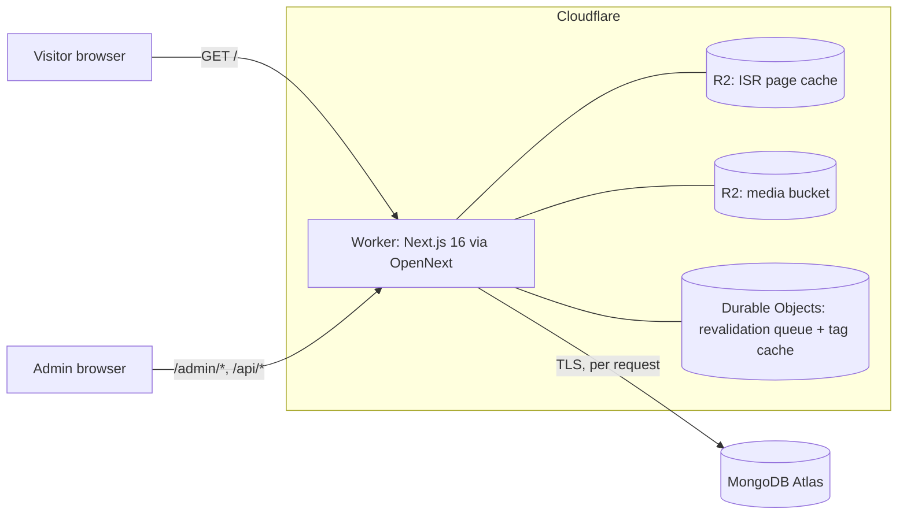

# Radhamadhob CMS — Documentation

Website and content management system for **রাধামাধব সনাতন সাংস্কৃতিক জোট
(Radhamadhob Sanatan Cultural Alliance)**. One Next.js application serves the
bilingual (বাংলা / English) public website and the password-protected admin
dashboard that edits every part of it. Content lives in MongoDB, admin-uploaded
images live in Cloudflare R2, and the whole app runs on Cloudflare Workers.

## Start here

| If you want to… | Read |
| --- | --- |
| Understand the system in 10 minutes | [Architecture](architecture.md) |
| Know what the site and the dashboard can do | [Features](features.md) |
| Run it on your machine | [Development guide](development.md) |
| Deploy it to Cloudflare | [DEPLOYMENT.md](../DEPLOYMENT.md) |
| Look up a MongoDB collection or field | [Data model](data-model.md) |
| Call or change an HTTP endpoint | [API reference](api-reference.md) |
| Understand sign-in, tokens, roles and hardening | [Authentication & security](auth-and-security.md) |
| Understand how image uploads work | [Media uploads (R2)](media-uploads.md) |
| Create admins, reset passwords, fix problems | [Operations runbook](operations.md) |

## The project in one picture



## Tech stack

| Layer | Choice |
| --- | --- |
| Framework | Next.js **16.3.8** (App Router, Turbopack), React 19, TypeScript |
| Styling / motion | Tailwind CSS 4, `motion`, `three` (hero 3D canvas), `lucide-react` icons |
| Auth | NextAuth **v4** (Credentials provider, JWT session strategy), `jose` |
| Database | MongoDB Atlas via the official `mongodb` driver (no ORM) |
| File storage | Cloudflare R2 (`MEDIA_BUCKET`) |
| Hosting | Cloudflare Workers via `@opennextjs/cloudflare` |
| Tooling | `tsx` scripts, `wrangler` CLI |

## Repository layout

```text
.
├── DEPLOYMENT.md              Cloudflare deployment guide
├── docs/                      This documentation
├── next.config.ts             Security headers, local Cloudflare bindings for `next dev`
├── open-next.config.ts        ISR cache (R2) + revalidation (Durable Objects)
├── wrangler.jsonc             Worker name, bindings (R2, DO, assets), placement
├── public/                    Static files: stage photos, robots.txt, sitemap.xml, _headers
├── scripts/
│   ├── seed-cms.ts            Fill EMPTY collections with the built-in content
│   ├── set-admin-password.ts  Create an admin / set or reset a password
│   └── cf-strip-env.mjs       Keep local .env values out of the Worker bundle
└── src/
    ├── app/                   Next.js routes (pages + route handlers)
    │   ├── layout.tsx         <html>, global metadata, JSON-LD
    │   ├── page.tsx           Public home page (SSG + ISR)
    │   ├── admin/[[...slug]]/ Admin dashboard (dynamic, noindex)
    │   ├── api/auth/          NextAuth endpoints
    │   ├── api/cms/           CMS collection read/write API
    │   ├── api/media/         Image upload API (→ R2)
    │   └── media/[...key]/    Public image delivery (← R2)
    ├── middleware.ts          Edge route guard for /admin and write APIs
    ├── App.tsx                Public single-page site (all sections)
    ├── AdminApp.tsx           Admin shell → AdminDashboardCMS
    ├── components/            UI sections and admin panels
    ├── context/               LanguageContext (bn/en switching, digits)
    ├── data/                  Record types, seed content, normalizers, client load/save helpers
    ├── hooks/useCmsCollections.ts  Single source of truth for all CMS state in the browser
    ├── lib/cmsClient.ts       Browser data client (fetch, save, upload, live sync)
    ├── lib/server/            Server-only: MongoDB, auth, tokens, repository, media storage
    ├── locales/               bn.json / en.json UI strings
    └── types/next-auth.d.ts   Session/JWT type extensions
```

## Conventions worth knowing before you change anything

- **Next.js 16 differs from older versions.** Read the matching guide in
  `node_modules/next/dist/docs/` before writing code (see `AGENTS.md`).
- **Keep `src/middleware.ts`.** Do not migrate to `proxy.ts`; OpenNext on Workers
  does not reliably support it yet. The deprecation warning is expected.
- **Do not upgrade Next past 16.3.x** without a matching `@opennextjs/cloudflare`
  release; see the version notes in [DEPLOYMENT.md](../DEPLOYMENT.md).
- **The visual design and visible text are owned by the organization.** Code
  changes should not alter layout, styling or copy unless that is the task.
- **Admin sign-in is email + password only.** No registration, no OAuth.
- Server-only modules start with `import 'server-only'` and live in `src/lib/server/`.
