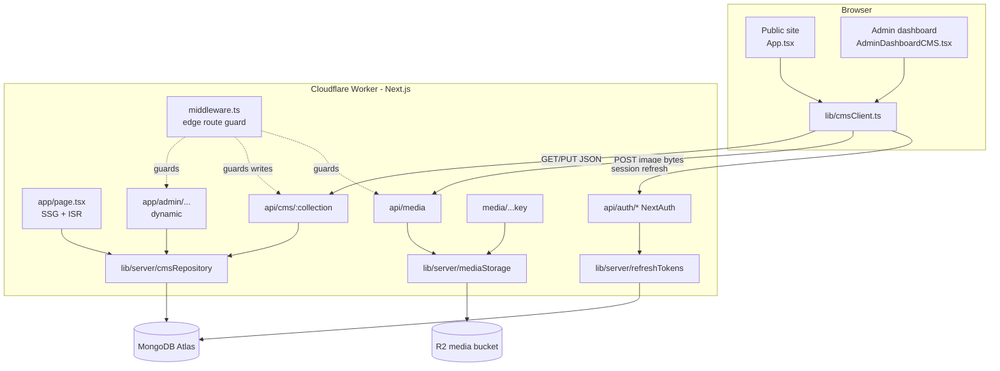
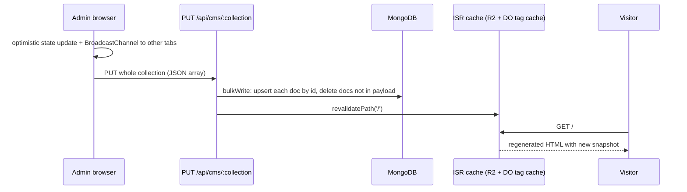

# Architecture

## 1. Big picture

The project is a single Next.js 16 application with two faces:

- **Public website (`/`)**: a bilingual single-page site (hero, about, programs,
  gallery, members, dramas & videos, contact/privacy footer).
- **Admin dashboard (`/admin/*`)**: ten content modules that edit everything the
  public site shows.

Both are compiled by OpenNext into one **Cloudflare Worker**. All content is stored in
**MongoDB Atlas**; admin-uploaded images are stored in **Cloudflare R2**, and MongoDB
documents keep only their URLs.

## 2. Request types and how each is served

| Request | Handler | Rendering / caching | Auth |
| --- | --- | --- | --- |
| `GET /` | `src/app/page.tsx` | Static HTML regenerated by ISR (`revalidate = 300`) and on demand after each dashboard save (`revalidatePath('/')`). Cached in R2. | none |
| `GET /admin/*` | `src/app/admin/[[...slug]]/page.tsx` | Dynamic (`force-dynamic`), `noindex`, `Cache-Control: no-store` | middleware redirects to `/admin/login` without a live session |
| `GET /api/cms/:collection` | `src/app/api/cms/[collection]/route.ts` | Dynamic, `no-store` | public, except `users` |
| `PUT/POST /api/cms/:collection` | same | Dynamic | admin access token; `users` needs `admin`/`super_admin` |
| `POST /api/media` | `src/app/api/media/route.ts` | Dynamic | admin access token |
| `GET /media/<key>` | `src/app/media/[...key]/route.ts` | Streams from R2, `immutable` caching + ETag | public |
| `/api/auth/*` | `src/app/api/auth/[...nextauth]/route.ts` | NextAuth v4 | — |
| `/_next/static/*`, `/assets/*` | Workers static assets (`public/_headers`) | Long-lived cache, served before the Worker runs | public |

## 3. Public site rendering

1. At build time and on each regeneration, `page.tsx` calls `readPublicSnapshot()`
   (`cmsRepository.ts`), which reads **all ten public collections** from MongoDB in
   parallel.
2. The snapshot is embedded in the page as `initialData` and passed to
   `PublicSite` → `App`.
3. `App` is loaded with `dynamic(..., { ssr: false })`: the interactive site sizes
   itself from the viewport and stored language preference, so it mounts in the
   browser. Metadata, JSON-LD and the data snapshot come from the server, so
   visitors never see seed content flash.
4. In the browser, `useCmsCollections(initialData)` turns the snapshot into React
   state. It falls back to the built-in seed content in `src/data/*` when a
   collection is empty or the database was unreachable during the build.
5. It then re-fetches each collection once and subscribes to updates:
   - same browser: `BroadcastChannel` + window events fire instantly when an admin
     tab saves;
   - other visitors: a throttled re-fetch when the tab regains focus (at most every
     30 s).

## 4. Admin dashboard

- `app/admin/[[...slug]]/page.tsx` renders on every request. It reads the public
  snapshot **and decodes (never rotates) the session cookie**, so the dashboard
  opens already signed in without a loading flash.
- `AdminSite` wraps the app in NextAuth's `SessionProvider` (polls
  `/api/auth/session` every 4 minutes and on window focus — this is what rotates
  tokens).
- `AdminDashboardCMS.tsx` holds the shell, sidebar, login form, dashboard overview,
  settings, members and dramas modules. The other modules (programs, events,
  gallery, videos, SEO, privacy policy) are in `AdminCmsSubPanels.tsx`.
- Client-side routing between modules uses `history.replaceState`
  (`/admin/members`, `/admin/drama`, …); every such URL is served by the same
  catch-all page.

## 5. Write path (dashboard → database)

Every collection is saved **as a whole**:

1. A module calls `onUpdateX(updatedArray)` from `useCmsCollections`.
2. The hook updates React state immediately, then calls the collection's
   `save…ToDatabase()` helper in `src/data/*`, which calls
   `syncCollection(name, records)` in `cmsClient.ts`.
3. `syncCollection` broadcasts to other tabs and sends `PUT /api/cms/:name` through
   `authorizedFetch` (refreshes an expired access token once and retries).
4. The route validates the payload (array of objects, unique string `id`s; strips
   `_id`; 25 MB limit) and calls `writeCollection` → `replaceAll`: one `bulkWrite`
   that upserts every document by `id` and deletes documents whose `id` is no longer
   present.
5. For public collections, `revalidatePath('/')` regenerates the home page.

The `users` collection uses `writeAdminUsers` instead, which whitelists fields,
keeps password hashes server-side and revokes sessions of removed or re-addressed
admins (see [auth-and-security.md](auth-and-security.md)).

## 6. Images

Admin images are resized/compressed in the browser, uploaded as raw bytes to
`POST /api/media`, stored in R2 under a random immutable key, and served from
`/media/<key>`. MongoDB stores only that URL. Built-in stage photography ships in
`public/assets/images/` and is served as static assets. Details:
[media-uploads.md](media-uploads.md).

## 7. Runtime: Cloudflare Workers via OpenNext

| Concern | How it is handled |
| --- | --- |
| Build | `npm run cf:build` = `opennextjs-cloudflare build` (runs `next build`) + `scripts/cf-strip-env.mjs`, which empties the compiled `.env` values so the Worker reads config only from Cloudflare vars/secrets |
| Static files | `ASSETS` binding (`.open-next/assets`), headers from `public/_headers` |
| ISR cache | R2 bucket `radhamadhob-next-cache` (`NEXT_INC_CACHE_R2_BUCKET`) |
| Time-based revalidation | Durable Object queue `DOQueueHandler` (`NEXT_CACHE_DO_QUEUE`) |
| On-demand revalidation | Durable Object sharded tag cache `DOShardedTagCache` (`NEXT_TAG_CACHE_DO_SHARDED`) |
| Self-calls for revalidation | Service binding `WORKER_SELF_REFERENCE` → `radhamadhob` |
| Media | R2 bucket `radhamadhob-media` (`MEDIA_BUCKET`) |
| Placement | `placement: smart`, so the Worker runs near MongoDB Atlas (fewer slow round trips) |
| MongoDB connections | Workers cannot share sockets between requests, so `withDb()` opens and closes a client **per call** on Workers and keeps a pooled client on Node.js (`src/lib/server/mongodb.ts`) |
| Middleware | Edge `middleware.ts` (Next 16 `proxy.ts` is Node-only and not reliably supported by OpenNext yet) |
| Local `next dev` | `next.config.ts` calls `initOpenNextCloudflareForDev()` so the wrangler bindings (R2 media bucket) are simulated locally under `.wrangler/state` |

## 8. Internationalization

- `LanguageContext` provides `lang` (`bn` default, `en`), `t(bn, en)`, `tKey(path)`
  over `src/locales/{bn,en}.json`, category translation and Bengali/English digit
  conversion.
- The choice is stored in `localStorage` (`selectedLanguage`) and sets
  `<html lang>`.
- CMS records carry both languages side by side (`title_bn` / `title_en`,
  `description_bn` / `description_en`, …). Normalizers in `src/data/*` fill missing
  variants so older documents keep working.

## 9. Key design decisions

| Decision | Why |
| --- | --- |
| Whole-collection `PUT` instead of per-document CRUD | The dashboard already holds the full list in memory; one request keeps MongoDB and the UI in step. Collections are small. Trade-off: last write wins (see [operations.md](operations.md#known-limitations)). |
| SSG + ISR for `/` | Visitors get a static page with live content; MongoDB is hit only on regeneration. |
| Tokens inside the NextAuth cookie, rotation only in `/api/auth/session` | That is the only place NextAuth can write a new cookie; API routes only verify. |
| Raw `mongodb` driver, no ORM | Few collections, document-shaped data, minimal bundle size on Workers. |
| R2 behind the Worker (`/media/*`) by default | Works with zero extra DNS/bucket setup; a public bucket domain can be switched on with `MEDIA_PUBLIC_BASE_URL`. |
| Images resized in the browser | Keeps uploads small and fast without image processing on the Worker. |
