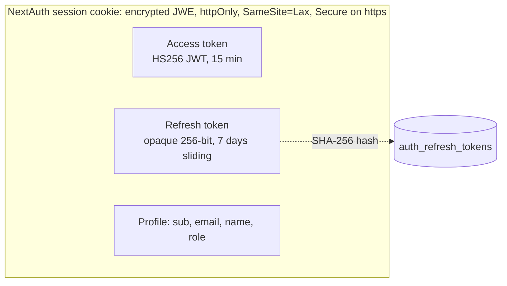
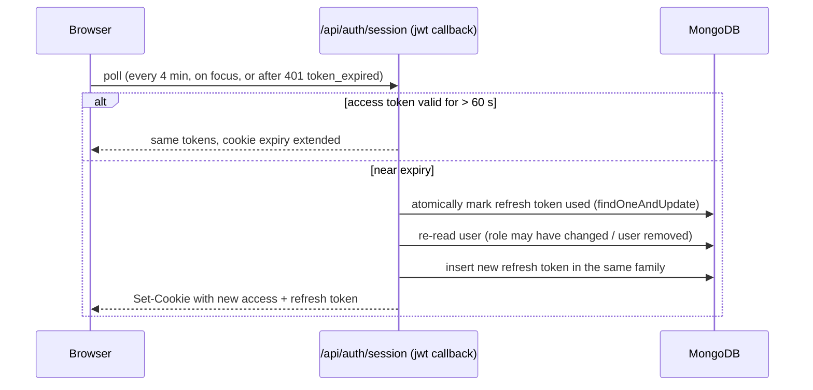

# Authentication & security

## Sign-in

- **Email + password only** (NextAuth Credentials provider). No registration, no
  OAuth, no account auto-creation.
- `authenticateWithPassword()` (`src/lib/server/adminAuth.ts`):
  1. normalizes the email (trim, lower-case), rejects passwords shorter than 6
     characters;
  2. refuses if the email is locked out (8 failures within 15 minutes);
  3. verifies the password against `users.passwordHash`. Unknown emails still pay
     for one hash check so timing does not reveal which emails exist;
  4. on failure, counts the attempt; on success, clears the counter and records
     `lastLoginAt`.
- Passwords use **PBKDF2-HMAC-SHA256, 600,000 iterations**, 16-byte random salt,
  constant-time comparison (`src/lib/server/passwords.ts`, Web Crypto, so it runs
  on Workers).

## Session and tokens

| Token | Format | Lifetime | Verified by |
| --- | --- | --- | --- |
| Access | HS256 JWT (`iss=radhamadhob-cms`, `aud=radhamadhob-cms-api`, `sub`, `email`, `role`, `jti`). Key = SHA-256(`NEXTAUTH_SECRET` + domain label), so it never equals the cookie key | 15 min (`ACCESS_TOKEN_TTL_SECONDS`, min 120 s) | `requireAdmin()` on every protected route, **without** a database call |
| Refresh | 32 random bytes, base64url; only its SHA-256 is stored | 7 days from last rotation, never beyond 30 days from sign-in | MongoDB, on every rotation |

Both tokens live **inside** the encrypted NextAuth cookie; page JavaScript never
sees them.

### Rotation

- Rotation happens **only** in the NextAuth `jwt` callback (i.e. on
  `/api/auth/session`), because that is the only place a new cookie can be written.
  The admin page and middleware only decode the cookie.
- **Reuse detection:** if a refresh token that was already used is presented again
  more than 30 s later, the whole family (that sign-in) is revoked and the session
  ends. Inside the 30 s grace window (two tabs refreshing at once) a sibling pair
  is issued.
- **Revocation triggers:** sign-out (family), password reset via script (all of the
  user's tokens), removing an admin or changing their email (all of the user's
  tokens), user deleted from the database (family, at next rotation).
- Role changes take effect at the next rotation (≤ ~15 minutes).

### Request authorization

| Layer | Check |
| --- | --- |
| `src/middleware.ts` (edge) | `/admin/*`: redirect to `/admin/login?callbackUrl=…` unless the cookie has a live, error-free session. `/api/cms/*` and `/api/media` writes: 401 without a live session. Safe `callbackUrl` only (`/admin…`, no `//`). Adds `noindex` + `no-store` to admin pages. |
| `requireAdmin()` (route) | Optional same-origin check for writes → verify access token (signature, issuer, audience, expiry) → optional role check. |
| Repository | Whitelisted collection names; `users` writes whitelist fields and protect self-removal / last admin. |

## Hardening in place

| Area | Measure |
| --- | --- |
| CSRF | SameSite=Lax cookie + `Origin` must match host on every write |
| Brute force | Per-email lockout (8 / 15 min), uniform timing for unknown emails |
| Secrets in bundles | `cf-strip-env.mjs` removes compiled `.env` values from the Worker; runtime secrets come from Cloudflare only |
| Data exposure | `_id` and `passwordHash` are never returned; DB errors return a generic 503 |
| Uploads | Type detected from file bytes (JPEG/PNG/WEBP/GIF only, no SVG/HTML), 10 MB cap, random keys; served with `nosniff` and a sandboxing CSP |
| Headers | `X-Content-Type-Options: nosniff`, `Referrer-Policy: strict-origin-when-cross-origin`, `X-Frame-Options: SAMEORIGIN` on every page; `X-Robots-Tag: noindex` on admin |
| Admin pages | Never cached (`no-store`), never indexed |

## Known gaps (from the October 2026 token review)

These are not fixed yet; each is small.

1. **Database blip signs the admin out.** If MongoDB is unreachable while the access
   token is expired, the session refresh keeps the old token without an error,
   the retried request fails again with `token_expired`, and `authorizedFetch`
   signs the user out. Fix: only sign out on `session.error` / no session.
2. **Lost refresh response looks like theft.** If a rotation succeeds on the server
   but the response never reaches the browser, the next refresh (> 30 s later)
   reuses the old token and revokes the session. A longer grace window reduces it.
3. **Poll vs. refresh margin.** The 4-minute poll with a 60-second refresh margin
   leaves 1–3 minutes per cycle where the access token is expired; requests then
   use the 401-and-retry path. A margin ≥ the poll interval closes the gap.
4. **Revocation latency.** Protected routes trust the access token for up to 15
   minutes after revocation, and the dashboard shows a revoked session as signed
   in until its next poll.

## Secrets and configuration

| Variable | Where | Notes |
| --- | --- | --- |
| `NEXTAUTH_SECRET` | `.env.local`, Cloudflare secret | Encrypts the cookie and derives the access-token key. Rotating it signs everyone out. Use a different value per environment. |
| `NEXTAUTH_URL` | `.env.local`, Cloudflare secret | Must be the public **https** URL in production; it decides the `__Secure-` cookie name that the middleware also reads. |
| `DB_URL` | `.env.local`, Cloudflare secret, build variable | MongoDB connection string. |
| `ACCESS_TOKEN_TTL_SECONDS` | optional | Access-token lifetime (default 900). |
