# Media uploads (Cloudflare R2)

Admin images are stored in the R2 bucket **`radhamadhob-media`** (binding
`MEDIA_BUCKET`). MongoDB documents store only the image URL.

## Flow

```mermaid
sequenceDiagram
  participant P as Admin panel (any image field)
  participant H as validateAndOptimizeUploadedImage()<br/>src/data/cmsDatabase.ts
  participant C as uploadImage()<br/>src/lib/cmsClient.ts
  participant API as POST /api/media
  participant R2 as R2 MEDIA_BUCKET
  participant DB as MongoDB
  P->>H: File from <input type="file">
  H->>H: check extension/type and 15 MB limit
  H->>H: decode, scale to ≤ maxDimension, re-encode (JPEG 0.78, or PNG for small logos)
  H->>C: optimized Blob
  C->>API: raw bytes (authorizedFetch: refresh + retry on token_expired)
  API->>API: admin + same-origin, ≤ 10 MB, detect type from bytes
  API->>R2: put images/YYYY/MM/<uuid>.<ext>
  API-->>C: { key, url }
  C-->>P: url
  P->>DB: saved with the record (PUT /api/cms/:collection)
```



| Field | Max dimension |
| --- | --- |
| Logo | 420 px (PNG kept as PNG) |
| Member photo | 900 px |
| Everything else | 850 px |

If the browser cannot decode the file, the original file is uploaded and the
server's signature check decides.

## Storage layout

```text
radhamadhob-media/
└── images/
    └── 2026/
        └── 10/
            └── 6f1c0d2e-…-e2.jpg     content-type + cache-control set on upload
```

- Keys are random UUIDs and never overwritten, so delivery uses
  `Cache-Control: public, max-age=31536000, immutable`.
- Custom metadata: `uploadedBy` (admin user id), `uploadedAt`.

## Delivery

By default images are served by the Worker at **`/media/<key>`**
(`src/app/media/[...key]/route.ts`): R2 handles `If-None-Match` (304), and
responses carry `nosniff` and `Content-Security-Policy: default-src 'none'; sandbox`.

**Optional: public bucket domain.** To serve images straight from Cloudflare's CDN
without invoking the Worker:

1. R2 → `radhamadhob-media` → Settings → connect a custom domain (for example
   `media.example.org`).
2. Set the Worker variable `MEDIA_PUBLIC_BASE_URL=https://media.example.org`.

New uploads then return `https://media.example.org/images/…`. Existing `/media/…`
URLs keep working because the route stays in place.

## Code map

| File | Role |
| --- | --- |
| `src/data/cmsDatabase.ts` → `validateAndOptimizeUploadedImage()` | Browser validation, resize, upload; returns `{ url, width, height, … }`. Every admin image field calls it. |
| `src/lib/cmsClient.ts` → `uploadImage()` | `POST /api/media` with auth refresh; throws `CmsRequestError` |
| `src/app/api/media/route.ts` | Auth, size limit, signature check, store |
| `src/app/media/[...key]/route.ts` | Public delivery |
| `src/lib/server/mediaStorage.ts` | R2 access (`getCloudflareContext`), type detection, key and URL rules |
| `wrangler.jsonc` → `r2_buckets` | `MEDIA_BUCKET` binding |
| `next.config.ts` | `initOpenNextCloudflareForDev()` so `next dev` gets a local R2 simulation |

## Local development

`npm run dev` simulates the bucket under `.wrangler/state/` (git-ignored). Nothing
is uploaded to the real bucket from your machine. `npm run cf:preview` uses the same
local simulation.

To inspect or put local objects:

```bash
npx wrangler r2 object put radhamadhob-media/images/2026/10/<uuid>.png --file ./x.png --content-type image/png --local
npx wrangler r2 object get radhamadhob-media/images/2026/10/<uuid>.png --file ./out.png --local
```

## Setup in production

```bash
npx wrangler r2 bucket create radhamadhob-media
```

Then deploy. If the binding is missing, uploads return `503 media_storage_unavailable`.

## Limitations

- **Orphans are not deleted.** Replacing or removing an image, or cancelling a form
  after uploading, leaves the old object in R2. Storage is cheap; a cleanup job
  could compare R2 keys with URLs referenced in MongoDB.
- **Older content keeps base64 images** inside documents until those images are
  re-uploaded from the dashboard. They keep displaying normally.
- **Upload errors are visible only in the Programs panel** (it has an error slot).
  Other panels leave the previous image in place when an upload fails; the reason
  is logged in the browser console.
- GIFs are re-encoded through a canvas, so animation is lost (unchanged from before).
